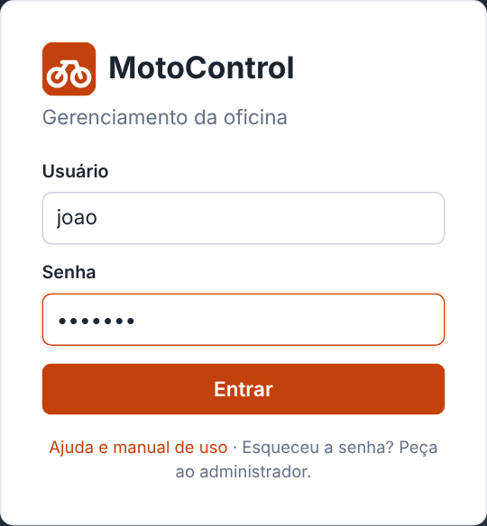
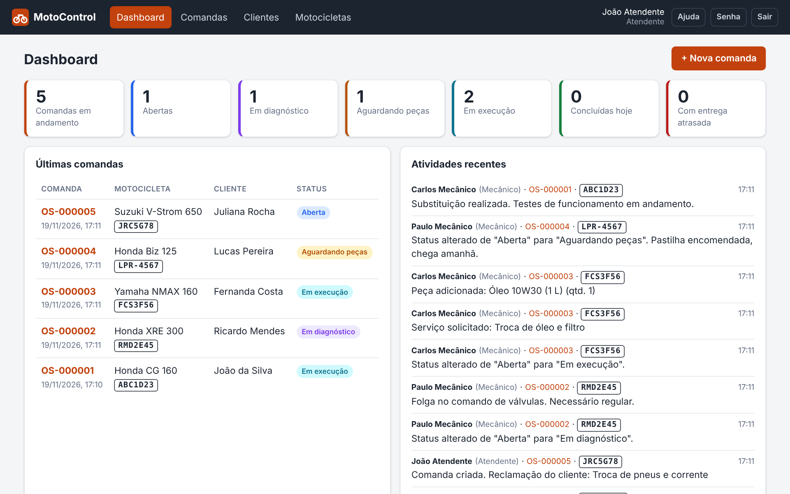

# Primeiros passos

## Abrindo o sistema

O MotoControl funciona pelo **navegador** (Chrome, Edge ou Firefox), em qualquer computador ligado à rede da oficina. Não é preciso instalar nada nos computadores dos funcionários.

- **No computador servidor:** clique duas vezes no atalho **MotoControl** da área de trabalho.
- **Nos outros computadores:** clique no atalho **MotoControl** que o responsável copiou para a área de trabalho, ou digite no navegador o endereço do servidor — por exemplo, `http://192.168.0.100:3000`. Peça o endereço ao responsável pelo sistema.

> Dica: depois de abrir, adicione a página aos favoritos do navegador.

## Entrando com o seu usuário

Cada funcionário tem **o próprio usuário e senha**. Isso é o que permite ao sistema registrar quem fez cada coisa — por isso, **não use a conta de outra pessoa** e não compartilhe a sua senha.

1. Digite o **usuário** e a **senha** fornecidos pelo administrador.
2. Clique em **Entrar**.
3. No primeiro acesso, o sistema pede que você **crie uma senha nova** (mínimo de 6 caracteres).
4. **Só para o administrador, uma única vez:** depois da senha, aparece a tela **Bem-vindo ao MotoControl**, pedindo o nome e a logo da oficina. Preencha e clique em **Salvar e continuar**, ou em **Pular por enquanto** — dá para fazer depois em [Administração](05-administracao.md#identidade-da-oficina). Essa tela não volta a aparecer.

Errou a senha 5 vezes seguidas? O acesso fica bloqueado por 5 minutos. Esqueceu a senha? Peça ao administrador para redefini-la (veja [Administração](05-administracao.md#redefinir-a-senha-de-alguém)).

## Conhecendo a tela

**Barra superior** — o menu muda conforme o seu perfil:

| Menu | O que tem |
|---|---|
| **Dashboard** | Resumo da oficina: quantas motos em cada situação, últimas comandas e o que cada funcionário registrou recentemente |
| **Comandas** | Todas as comandas, com filtros de busca |
| **Clientes** | Cadastro dos donos das motos |
| **Motocicletas** | Cadastro das motos e o histórico de manutenção de cada uma |
| **Funcionários** | (só administrador) Contas de acesso |
| **Administração** | (só administrador) Backups e auditoria |

À direita ficam o seu nome, o botão **Ajuda** (este manual), **Senha** (trocar a sua senha) e **Sair**.

**Cartões do Dashboard** — clique em um deles para ver a lista das comandas naquela situação. O cartão **Com entrega atrasada** mostra comandas cuja previsão de entrega já passou.

## O que cada perfil pode fazer

| | Administrador | Atendente | Mecânico | Consulta |
|---|:-:|:-:|:-:|:-:|
| Ver comandas, clientes e motos | ✓ | ✓ | ✓ | ✓ |
| Cadastrar clientes e motos | ✓ | ✓ | | |
| Abrir comanda | ✓ | ✓ | | |
| Registrar diagnóstico e serviço executado | ✓ | | ✓ | |
| Adicionar serviços e peças | ✓ | | ✓ | |
| Registrar observação | ✓ | ✓ | ✓ | |
| Mudar a situação e concluir a comanda | ✓ | ✓ | ✓ | |
| Cancelar comanda | ✓ | ✓ | | |
| Funcionários, backups e auditoria | ✓ | | | |

Se um botão não aparece para você, é porque o seu perfil não tem essa permissão.

## Saindo

Clique em **Sair** ao terminar, principalmente em computadores compartilhados. Por segurança, a sessão também expira depois de 12 horas sem uso.

---

Próximo: [Comandas](02-comandas.md)
