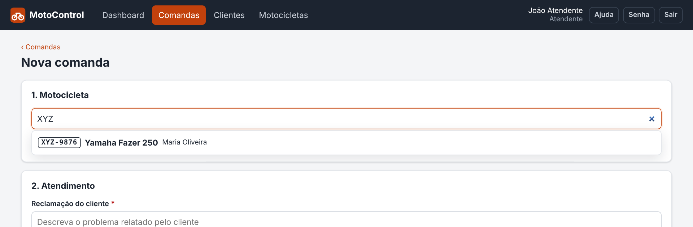
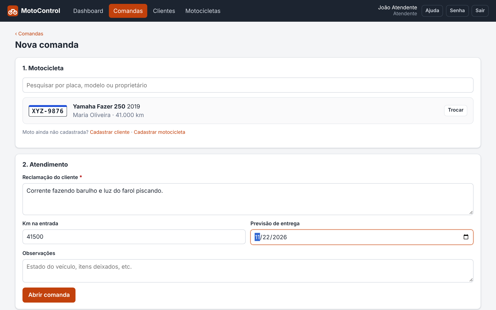
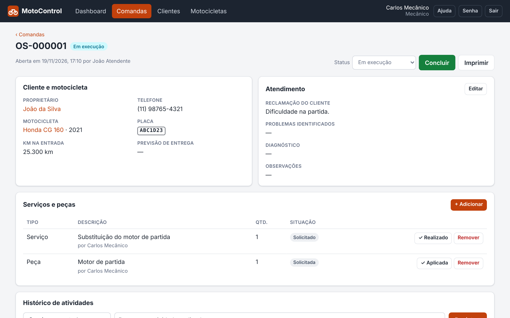
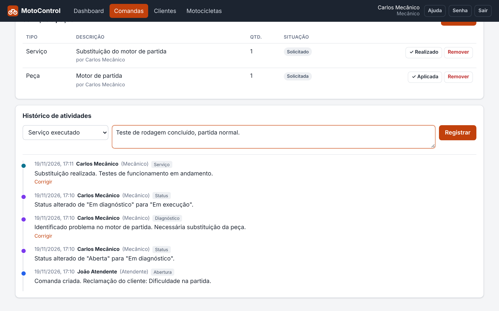
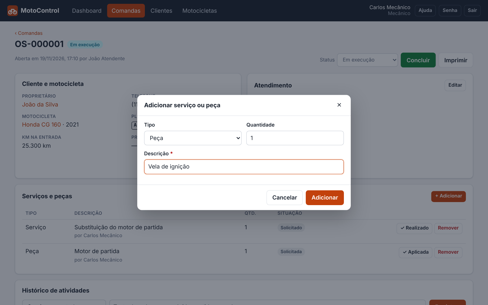
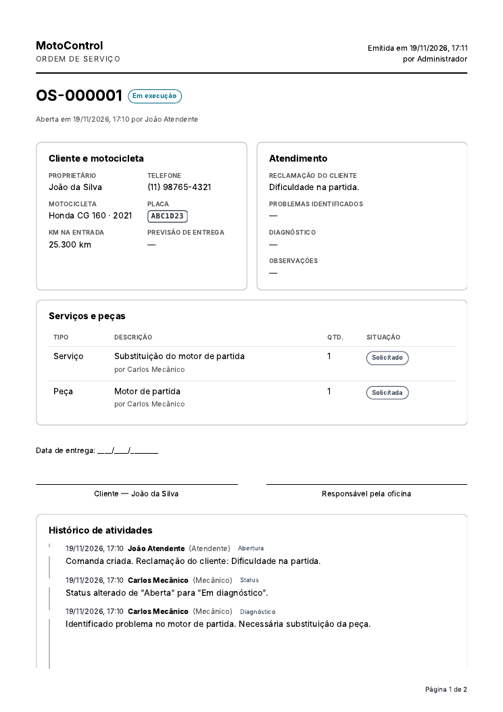

# Comandas

A comanda é o registro de **uma entrada da moto na oficina**. Cada comanda recebe um número sequencial (`OS-000001`, `OS-000002`...) e reúne: cliente, moto, reclamação, diagnóstico, serviços, peças e o histórico de tudo o que foi feito.

## Abrir uma comanda

*Quem pode: atendente e administrador.*

1. Clique em **+ Nova comanda** (no Dashboard ou em Comandas).
2. Em **1. Motocicleta**, digite a placa, o modelo ou o nome do dono e escolha a moto na lista.

   

   Moto ou cliente ainda não cadastrados? Use os links **Cadastrar cliente** e **Cadastrar motocicleta** logo abaixo — não é preciso sair da tela.
3. Em **2. Atendimento**, preencha:
   - **Reclamação do cliente** (obrigatório) — o que o cliente relatou, com as palavras dele.
   - **Km na entrada** — a quilometragem no painel. O sistema mostra a última registrada como referência.
   - **Previsão de entrega** — usada no Dashboard para indicar atrasos.
   - **Observações** — estado da moto na chegada, objetos deixados, arranhões etc.

   
4. Clique em **Abrir comanda**. O sistema mostra a comanda criada, já com o número.

> Uma moto não pode ter duas comandas em andamento ao mesmo tempo. Se ela já tiver uma aberta, o sistema avisa o número — continue usando aquela.

## A tela da comanda

| Área | O que mostra |
|---|---|
| **Topo** | Número, situação atual, quem abriu e quando. À direita: mudar situação, **Concluir**, **Cancelar**, **Imprimir** |
| **Cliente e motocicleta** | Dados de contato e da moto. Clique no nome ou no modelo para abrir o cadastro |
| **Atendimento** | Reclamação, problemas identificados, diagnóstico e observações. Botão **Editar** para alterar |
| **Serviços e peças** | O que precisa ser feito e o que já foi feito |
| **Histórico de atividades** | Linha do tempo de tudo o que aconteceu, do mais recente para o mais antigo |

## Mudar a situação (status)

Use a caixa **Status**, no topo da comanda. As situações são:

| Situação | Quando usar |
|---|---|
| **Aberta** | A moto chegou e ainda não foi avaliada |
| **Em diagnóstico** | O mecânico está investigando o problema |
| **Aguardando peças** | O serviço está parado esperando peça |
| **Em execução** | O mecânico está fazendo o serviço |
| **Concluída** | Serviço terminado — use o botão **Concluir** |
| **Cancelada** | O serviço não será feito — use o botão **Cancelar** |

Toda mudança de situação aparece no histórico com o nome de quem mudou.

## Registrar o trabalho (mecânico)

### Registrar uma atividade no histórico

No quadro **Histórico de atividades**:

1. Escolha o tipo:
   - **Serviço executado** — algo que você fez ("Regulada a folga das válvulas").
   - **Diagnóstico** — o que você descobriu ("Motor de partida em curto").
   - **Observação** — qualquer outra informação ("Cliente autorizou por telefone").
2. Descreva e clique em **Registrar**.

O registro sai com **o seu nome e o horário do servidor** — não é preciso escrever quem fez. Vários mecânicos podem registrar na mesma comanda.

### Adicionar serviços e peças

Em **Serviços e peças**, clique em **+ Adicionar**, escolha **Serviço** ou **Peça**, descreva e informe a quantidade.

Quando terminar um serviço, clique em **✓ Realizado** na linha dele (para peças: **✓ Aplicada**). O sistema registra quem fez e quando.

**Remover** tira o item da comanda (por exemplo, se o cliente desistiu daquele serviço). A remoção fica registrada no histórico.

### Preencher o diagnóstico da comanda

No quadro **Atendimento**, clique em **Editar** para preencher **Problemas identificados** e **Diagnóstico**. Esses campos aparecem na impressão e no histórico da moto. Toda edição fica no histórico com o valor novo.

## Corrigir um registro errado

Registros do histórico **não são apagados nem alterados** — isso garante que o histórico seja confiável. Para corrigir:

1. Clique em **Corrigir** abaixo do registro (aparece só nos registros que **você** fez; o administrador pode corrigir qualquer um).
2. Escreva o texto correto e salve.

O registro original continua visível, marcado como **corrigido**, e a correção aparece como um novo registro. Somente o administrador pode **remover** um registro, informando o motivo.

## Concluir a comanda

1. Marque todos os serviços como **✓ Realizado** (ou remova os que não serão feitos). O sistema não deixa concluir com serviço pendente.
2. Clique em **Concluir**, escreva observações finais se quiser (ex.: "Recomendada troca de pneu traseiro em 2.000 km") e confirme.

Depois de concluída, a comanda **não pode mais ser alterada**, mas continua disponível para consulta no histórico da moto.

## Cancelar a comanda

Clique em **Cancelar** e escreva a **justificativa** (obrigatória) — por exemplo, "Cliente não aprovou o orçamento". A comanda fica registrada como cancelada, com o motivo e quem cancelou.

## Imprimir ou salvar em PDF

Clique em **Imprimir**. Para gerar um PDF, escolha **Salvar como PDF** como impressora.

A impressão traz os dados da comanda, os serviços e peças, a **área de assinatura do cliente e do responsável** com a data de entrega e, no fim, o histórico de atividades. Use-a na entrega da moto.

## Quando aparece "a comanda foi alterada por outro usuário"

Duas pessoas editaram a mesma comanda ao mesmo tempo. O sistema não deixa uma alteração apagar a outra: ele recarrega a comanda com os dados mais recentes. Confira o que mudou e, se ainda for preciso, faça a sua alteração de novo.

---

Anterior: [Primeiros passos](01-primeiros-passos.md) · Próximo: [Clientes e motocicletas](03-clientes-e-motos.md)
