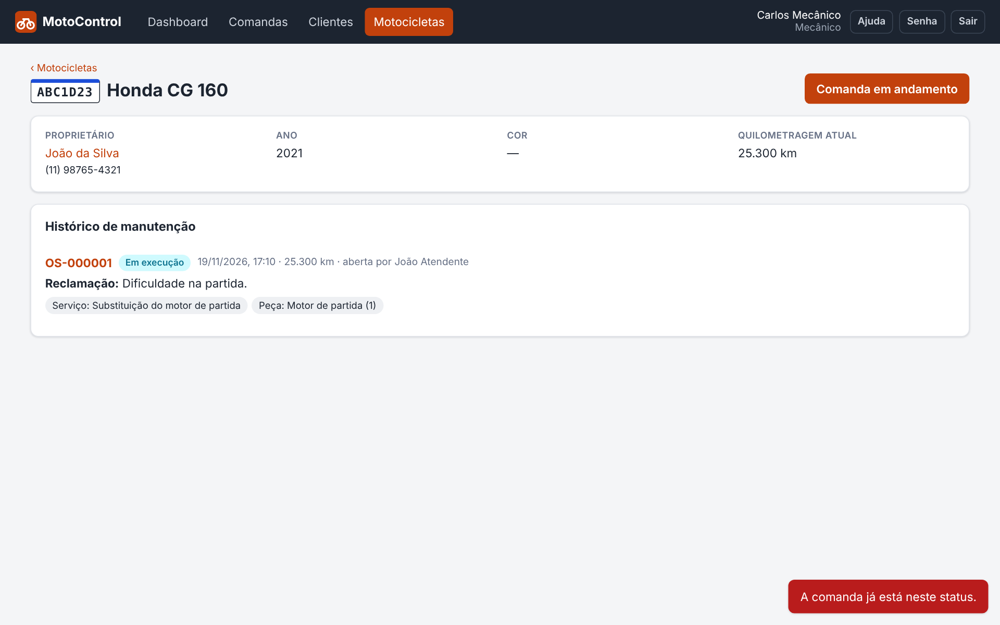

# Clientes e motocicletas

*Cadastrar e editar: atendente e administrador. Consultar: todos.*

Cada **cliente** pode ter várias **motocicletas**, e cada moto acumula todas as comandas que já teve — esse é o histórico de manutenção.

## Cadastrar um cliente

1. Menu **Clientes** → **+ Novo cliente**.
2. Preencha:

| Campo | Obrigatório | Observação |
|---|:-:|---|
| Nome completo | ✓ | |
| Telefone | ✓ | Com DDD. Pode digitar com ou sem parênteses e traço |
| CPF | | O sistema confere se o CPF é válido e não deixa cadastrar o mesmo CPF duas vezes |
| Endereço | | |
| Observações | | Preferências de contato, por exemplo |

3. Clique em **Salvar**. Você vai para a ficha do cliente, onde já pode cadastrar as motos dele.

## Cadastrar uma motocicleta

Na ficha do cliente, clique em **+ Motocicleta** (o dono já vem preenchido). Ou use o menu **Motocicletas** → **+ Nova motocicleta** e escolha o dono pesquisando pelo nome.

| Campo | Obrigatório | Observação |
|---|:-:|---|
| Proprietário | ✓ | Digite parte do nome e **clique** no cliente na lista |
| Placa | ✓ | Modelo antigo (`ABC-1234`) ou Mercosul (`ABC1D23`). Não pode repetir |
| Ano | ✓ | |
| Marca e Modelo | ✓ | A marca sugere as mais comuns enquanto você digita |
| Cor, Quilometragem atual, Observações | | A quilometragem é atualizada sozinha a cada comanda |

## Pesquisar

Nas listas de **Clientes** e **Motocicletas**, digite no campo de busca — a lista filtra enquanto você digita.

- **Clientes:** por nome, telefone ou CPF.
- **Motocicletas:** por placa (pode ser só um pedaço, como `1D2`), modelo, marca ou nome do dono.

Clique em uma linha para abrir a ficha.

## Ficha do cliente

Mostra os dados de contato, as **motos** do cliente (com o botão **Abrir comanda** em cada uma) e o **histórico de comandas** de todas as motos dele.

## Ficha da motocicleta e histórico de manutenção

Mostra os dados da moto e, abaixo, **todas as comandas que ela já teve**, da mais recente para a mais antiga: data, quilometragem, reclamação, diagnóstico e os serviços e peças. Use para responder perguntas como "quando foi a última troca de óleo?".

O botão **+ Abrir comanda** já abre a comanda com essa moto selecionada. Se a moto tiver uma comanda em andamento, aparece **Comanda em andamento** no lugar.

## Trocar o dono de uma moto

Abra a moto, clique em **Editar** e escolha o novo proprietário. O histórico de comandas continua com a moto, e a troca fica registrada na auditoria.

## Excluir

Só o administrador pode excluir, e **apenas cadastros sem nenhuma comanda** — por exemplo, um cadastro feito por engano. Clientes e motos com histórico não podem ser excluídos, para não perder o histórico da oficina.

---

Anterior: [Comandas](02-comandas.md) · Próximo: [Consultas e histórico](04-consultas-e-historico.md)
