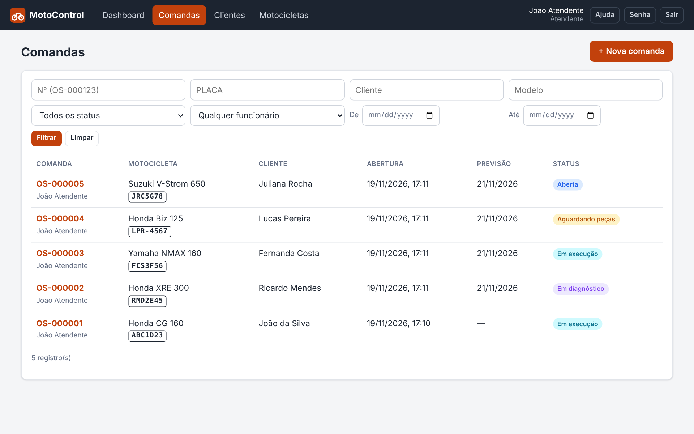

# Consultas e histórico

## Encontrar comandas

Menu **Comandas**. Combine quantos filtros quiser e clique em **Filtrar**:

| Filtro | Exemplo |
|---|---|
| **Nº** | `OS-000124`, `os124` ou só `124` |
| **Placa** | `ABC1D23` ou parte dela |
| **Cliente** | parte do nome |
| **Modelo** | `CG`, `Biz`, `XRE`... |
| **Status** | uma situação específica ou **Em andamento** (todas que ainda não foram concluídas nem canceladas) |
| **Funcionário** | comandas que a pessoa abriu, concluiu **ou** em que registrou alguma atividade |
| **De / Até** | período de **abertura** da comanda |

**Limpar** remove todos os filtros. A lista mostra 25 comandas por página; use **Próxima ›** para ver mais.

### Exemplos úteis

- **O que está parado esperando peça?** Status = *Aguardando peças*.
- **O que o Carlos fez este mês?** Funcionário = Carlos, De = dia 1.
- **Comandas canceladas na semana:** Status = *Cancelada* e o período.

Os cartões do **Dashboard** também são atalhos: clicar em *Em diagnóstico* abre a lista já filtrada.

## Histórico de uma moto

Abra a moto (menu **Motocicletas** ou pelo link na comanda). Veja [Ficha da motocicleta](03-clientes-e-motos.md#ficha-da-motocicleta-e-histórico-de-manutenção).

## Quem fez o quê numa comanda

Abra a comanda e veja o **Histórico de atividades**: cada linha mostra data, hora, funcionário, perfil e o tipo do registro. Os horários são do servidor, não do computador de quem registrou.

## Atividades recentes da oficina

O **Dashboard** mostra os últimos registros de todas as comandas — útil para o gerente acompanhar o andamento sem abrir cada uma.

---

Anterior: [Clientes e motocicletas](03-clientes-e-motos.md) · Próximo: [Administração](05-administracao.md)
