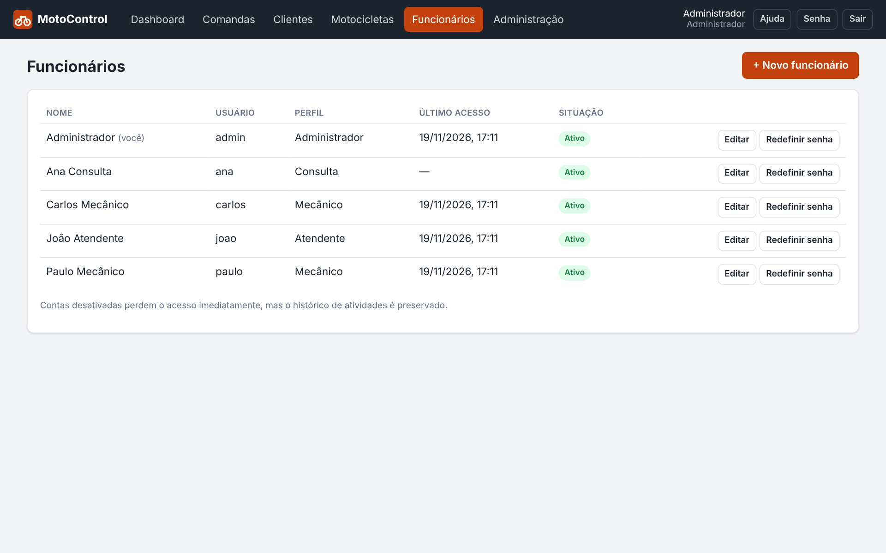
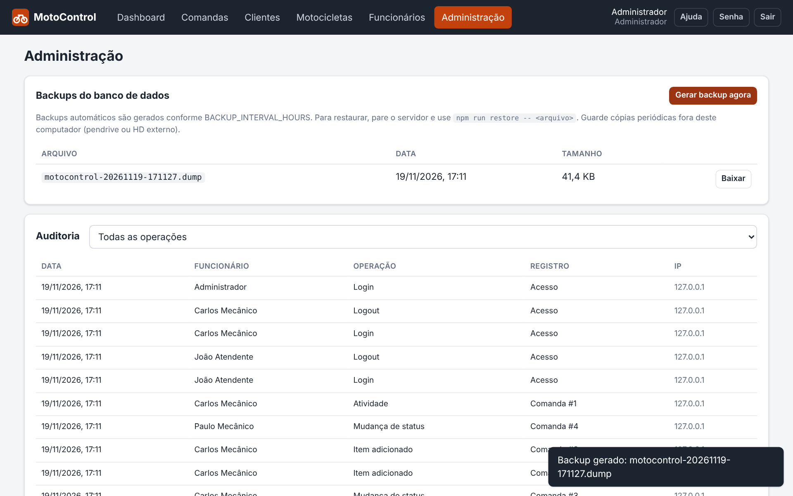

# Administração: funcionários, auditoria e backups

*Somente para o perfil Administrador.*

## Funcionários

Menu **Funcionários**.

### Cadastrar um funcionário

1. **+ Novo funcionário**.
2. Preencha nome, **usuário** (login — letras minúsculas, números, ponto ou hífen, ex.: `carlos.silva`), **perfil** e uma **senha inicial**.
3. Entregue o usuário e a senha ao funcionário. No primeiro acesso ele será obrigado a criar uma senha própria.

Escolha o perfil pelo que a pessoa faz — veja a tabela em [Primeiros passos](01-primeiros-passos.md#o-que-cada-perfil-pode-fazer). Na dúvida, dê o perfil com **menos** permissões; é fácil mudar depois.

### Desativar quem saiu da oficina

Clique em **Editar**, desmarque **Conta ativa** e salve. O acesso é cortado **na hora**, inclusive se a pessoa estiver com o sistema aberto. Todo o histórico do que ela registrou continua preservado — por isso funcionários **não são excluídos**, só desativados.

### Redefinir a senha de alguém

Clique em **Redefinir senha**, digite uma senha provisória e informe ao funcionário. Ele será obrigado a trocá-la no próximo acesso.

> Você não pode desativar nem tirar o perfil de administrador da sua própria conta. Mantenha sempre **pelo menos dois administradores** — se o único esquecer a senha, só o suporte técnico consegue recuperar o acesso.

## Identidade da oficina

Na primeira vez que o administrador entra no sistema, uma tela de boas-vindas já pede esses dados (pode ser pulada). Para alterar depois: menu **Administração** → **Identidade da oficina**. Aqui você coloca o **nome** e a **logo** da sua oficina. Eles passam a aparecer no lugar do MotoControl na barra do topo, na tela de entrada e no cabeçalho da comanda impressa.

- **Logo:** escolha um arquivo **PNG, JPG ou WEBP**. O sistema reduz a imagem automaticamente; prefira uma logo larga (horizontal) e com fundo branco ou transparente. SVG não é aceito.
- **Remover logo:** volta a aparecer o ícone do MotoControl. O nome pode ser apagado da mesma forma (deixe o campo vazio e salve).

A logo fica guardada no banco de dados, então entra nos backups junto com o resto. Só administradores podem alterá-la, e cada alteração fica na auditoria.

## Auditoria

Menu **Administração** → **Auditoria**. Registra as operações importantes: entradas e tentativas de entrada recusadas, cadastros, edições, exclusões, mudanças de situação, cancelamentos, remoções de registros, redefinições de senha e backups — sempre com funcionário, data e computador (IP).

Use o filtro para ver só um tipo de registro (Comanda, Cliente, Funcionário, Acesso...).

## Backups

O sistema faz **um backup automático por dia** e guarda os 30 mais recentes. Em **Administração** você pode:

- **Gerar backup agora** — por exemplo, antes de uma mudança grande.
- **Baixar** um backup — para guardar uma cópia fora do servidor.

> **Importante:** os backups ficam no próprio computador servidor. Se o disco dele estragar, os backups se perdem junto. **Pelo menos uma vez por semana, copie a pasta `backups` (dentro da pasta do MotoControl) para um pendrive ou HD externo**, e guarde-o fora da oficina se possível.

Restaurar um backup é feito no computador servidor — veja [Servidor, backup e atualização](06-servidor-e-backup.md#restaurar-um-backup).

---

Anterior: [Consultas e histórico](04-consultas-e-historico.md) · Próximo: [Servidor, backup e atualização](06-servidor-e-backup.md)
